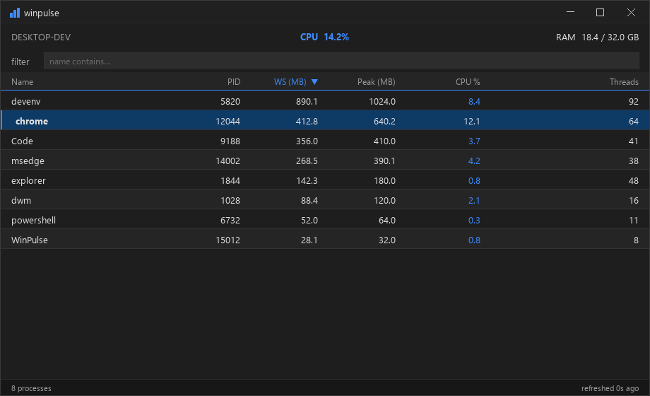

# winpulse

.NET 8 WinForms process monitor. CPU, RSS, peak WS, filter.



## interface

Dark 900×560 window. Toolbar, filter, list, status. No extra pages.

```
┌ winpulse ──────────────────────────────────────────────────┐
│ DESKTOP-DEV          CPU  14.2%          RAM  18.4 / 32 GB │
│ filter  [ name contains…                                 ] │
│ Name           PID     WS (MB)  Peak (MB)  CPU %  Threads  │
│ devenv         5820    890.1    1024.0      8.4   92       │
│ chrome         12044   412.8     640.2     12.1   64       │
│ …                                                          │
│ 8 processes · refreshed 0s ago                             │
└────────────────────────────────────────────────────────────┘
```

| control | what it does |
|---|---|
| **toolbar** | machine name, total CPU % (all cores = 100), RAM used / total |
| **filter** | keep rows whose process name contains the string (case-insensitive) |
| **list** | Name, PID, WorkingSet64 MB, PeakWorkingSet64 MB, CPU % (delta / interval / cores), ThreadCount |
| **column header** | click to sort. click again to reverse |
| **status** | visible row count, seconds since last sample |

Host CPU is a `GetSystemTimes` idle/kernel/user delta (all cores = 100). First host tick is `—`; the second is a number. RAM is `GlobalMemoryStatusEx`. Per-process CPU is `TotalProcessorTime` / wall / cores. Access-denied processes stay in the list (Name + PID; CPU `—`, WS/Peak/Threads `0`). `Process` handles are `Dispose`d in `finally`. Sampling runs off the UI thread; paint marshals back.

Read-only: `Process.GetProcesses`. No admin, no kernel, no injection.

## session

Window opens on this machine. Top line is hostname, total CPU, RAM used/total. List fills with live processes. Type in the filter to keep matching names. Click a column header to sort. Status bar reads `N processes · refreshed 0s ago`.

## build

```
dotnet build -c Release && dotnet run --project WinPulse
```

Tests: `dotnet test -c Release`.
